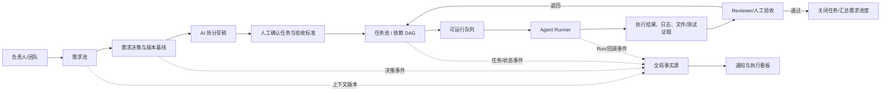
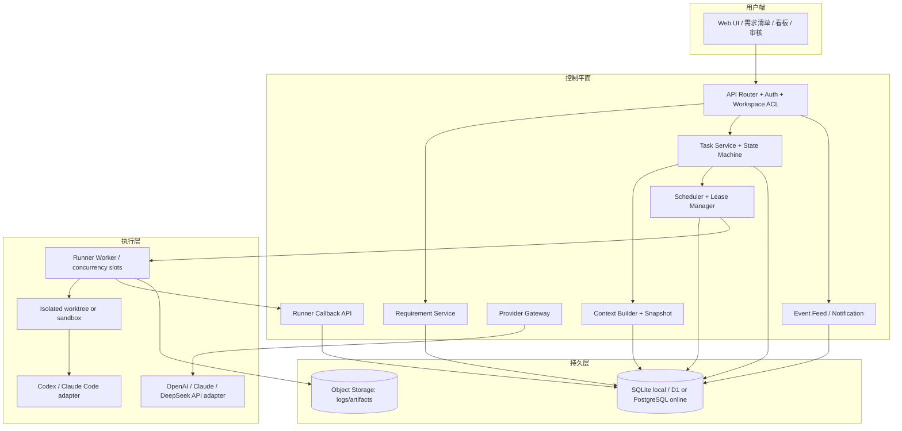

# AI 需求管理工作台：V1 产品与技术架构方案

> 版本：讨论稿 0.1　｜　目的：先统一数据、任务、Agent 和部署边界，再进入框架实现。  
> 本文是可编辑方案，不代表所有设计已经批准。V1 范围需要由产品负责人勾选确认。

## 0. 结论摘要

1. **全局上下文是一份结构化、可版本化的工作区事实，不是一段每次都塞给 Agent 的巨型 Prompt。**需求、决策、任务、当前状态和事件分别存储；运行时由上下文构建器按任务范围取数。
2. **每次任务运行使用不可变上下文快照。**独立/临时任务可执行后关闭，但仍记录执行结果和事件；不必永久保存整段对话。若任务范围或输入事实变化，要生成新快照/新运行，不能悄悄改写正在运行的输入。
3. **不要自研基础模型或一开始自研通用 Agent Runtime。**自建工作台的编排、权限、状态机、上下文、队列与适配器；先接一种执行器。模型 API 与可改文件的本地执行器是两个不同接口。
4. **本机调试：本地 API + SQLite；多人线上：中心 API + 云数据库 + 执行 Worker。**浏览器不直接连数据库，Agent/Worker 也不直接写业务表。
5. **V1 用数据库中的持久任务队列 + 一个 Worker slot 即可。**Redis、复杂调度器、多个并行 Agent、双向本地/云同步都不应成为 V1 前置条件。

## 1. 问题一：全局上下文、任务上下文包和快照如何分工？

### 1.1 不做“一个全局 Prompt”，做“一个全局事实源”

全局事实源（Workspace Context）由结构化数据组成：产品目标、术语、不可违反的约束、已确认决策、需求清单、任务清单、版本和事件。它有递增的 `workspace_revision`，但并不意味着每次运行都要把所有数据发送给模型。

上下文构建器根据 `task_id`、执行角色和输入版本，组合出最小任务包：

- 全局稳定规则与相关决策；
- 当前需求的 ID、版本、说明、决策及验收范围；
- 当前任务、验收标准、文件范围和负责人；
- 已完成依赖任务的结果摘要/产物引用；
- 必要时附加相关历史事件，而不是全部对话。

### 1.2 快照何时创建、临时任务如何关闭

**在任务真正启动/领取时创建快照**，记录全局上下文版本、需求 revision、任务 revision、依赖结果版本、Prompt 模板版本及引用的文件/产物。快照只增不改。

建议规则：

- 正式需求任务：快照和运行摘要长期保留，便于复盘和复现。
- 临时任务/一次性分析：同样创建运行快照，但完成后把任务状态设为 `closed`；保留任务摘要、结果、耗时、用量、事件和必要产物引用。原始模型对话/大量日志可按保留策略清理。
- 失败重试：每次重试创建新的 `task_run`；如果输入事实未变，可以引用同一快照。如果需求、验收标准、依赖产物或文件基线改变，先创建新快照。
- 任务完成但后来重开：新建一次运行并记录重新打开原因，不覆盖旧的完成记录。

这让团队回答“它当时按什么信息做的”，同时避免长期堆积完整聊天和无用 Token。

## 2. 问题二：成熟 API，还是本地 Codex / DeepSeek / Claude harness？

先区分三个概念：

| 概念 | 职责 | 例子 |
| --- | --- | --- |
| 模型 Provider | 生成文本、结构化拆分、分析、审查 | OpenAI API、Claude Messages API、DeepSeek API |
| Agent Executor | 拿到任务后，实际访问工作目录、调用工具、运行命令并回报结果 | 本地 Codex/Claude Code worker、托管 Agent Runtime |
| 工作台 Orchestrator | 权限、上下文、依赖、任务状态、调度、运行记录、验收 | 本产品后端 |

不要把“模型”字段和“执行器”字段合成一个 `agent_type`。任务可记录 `provider` / `model`；运行则记录 `executor_type` / `executor_id` / `run_id`。

### 2.1 推荐的接入路径

- **需求澄清/拆分/摘要/审查**：走服务端 Provider API 适配器。输入是有边界的上下文包，输出先作为草稿，需人确认后才生成正式任务。
- **需要改文件或运行测试的任务**：由本机或专用机器上的 Worker 调用本地执行器。Worker 从工作台领取任务，在独立目录/worktree 执行，再把日志和产物回传。
- **首个执行器**：优先接入你最常用、可稳定访问本地项目的 Codex 或 Claude Code 其中一个；不要同时做三家 CLI。DeepSeek 先作为可替换的模型 Provider。等任务协议和回传链路稳定后再加第二个执行器。
- **线上化**：网站后端不能直接操作用户桌面上的 Codex/Claude 会话。需要用户设备上的 Runner 主动连到服务端（轮询/拉取/长连接）或专用隔离 Runner。不要把桌面会话当成无认证的远程 API。

OpenAI 官方把托管 Codex harness 的 Agents API、由应用控制的 Agents SDK 和直接调用模型的 Responses API 区分为不同 Runtime 选择；Claude 平台提供 Messages API 及托管 Agent 能力；DeepSeek API 文档提供兼容 OpenAI/Anthropic SDK 风格的调用入口。实际接入要分别做 Provider/Executor 适配，不假设各家运行时和会话语义一致。参见文末官方资料。

### 2.2 API Key 与权限

- API Key 只存服务端 Secret/操作系统密钥库，不进浏览器、localStorage、任务 Prompt、导出 JSON 或 Git。
- Runner 使用短期、工作区限定、Run 限定的访问令牌，只能读取任务包、写运行事件/产物和提交结果。
- Runner 默认没有全库查询权限；任务包中有最小化的业务上下文。
- 代码执行采用最小权限：独立工作目录、可控命令、明确文件范围、可取消、超时和人工验收。

## 3. 问题三：基础架构组件、Router/Callback、任务池与线程池

### 3.1 后端模块

```text
Web UI
  └─ API Router（身份认证、工作区权限、输入校验、限流）
       ├─ Requirement Service（导入、决策、版本、拆分草稿）
       ├─ Task Service（任务、依赖、状态机、领取/验收）
       ├─ Context Builder（全局事实 → 有版本的任务上下文快照）
       ├─ Scheduler（依赖、文件范围、Worker 能力、并发上限）
       ├─ Provider Gateway（Claude / OpenAI / DeepSeek API adapters）
       ├─ Run Callback Service（进度、心跳、日志摘要、成功/失败、产物）
       ├─ Notification Service（事件流；先轮询，后 SSE/WebSocket）
       └─ Repository / Database

Local/Remote Runner
  ├─ Claim run → 获取签名任务包/快照
  ├─ 执行器适配器（Codex CLI / Claude Code / 未来其它执行器）
  ├─ 独立工作目录、文件范围、超时/取消
  └─ 回调 API：heartbeat / progress / result / failure / artifacts
```

Router 负责把 HTTP 请求分到正确 Service；业务规则不能写在前端点击回调里。Callback 是 Worker 把执行过程回传给工作台的 API，不是 Agent 任意写数据库。

### 3.2 推荐的 API 轮廓

| API | 用途 |
| --- | --- |
| `GET /api/v1/workspaces/:id/context` | 查看工作区当前 revision 和摘要 |
| `POST /api/v1/requirements/import-preview` | 解析文档/Payload 为待确认草稿 |
| `POST /api/v1/requirements/:id/split-drafts` | 产生任务拆分建议，不直接执行 |
| `POST /api/v1/requirements/:id/tasks/confirm` | 人确认拆分，建立任务和依赖 |
| `POST /api/v1/tasks/:id/runs` | 启动任务：验证依赖/范围、创建 Snapshot + Run + Event |
| `POST /api/v1/runner/claim` | Worker 原子领取一个可运行 Run |
| `POST /api/v1/runs/:runId/heartbeat` | 续租和报告活性 |
| `POST /api/v1/runs/:runId/events` | 回传阶段进度/日志摘要（幂等） |
| `POST /api/v1/runs/:runId/result` | 提交结果、产物引用和验证证据 |
| `POST /api/v1/runs/:runId/failure` | 提交错误类别、日志摘要、是否可重试 |
| `POST /api/v1/tasks/:id/accept` / `reject` | 人或 Reviewer 验收/退回 |

每个 Runner 回调都带 `run_id`、`event_id`、`context_snapshot_id`、`lease_token`、`expected_revision`；重复回调按 `event_id` 幂等处理，过期租约或旧 revision 拒绝写入。

### 3.3 “需求池、任务池、任务线程池”不是一回事

- **需求池**：所有待讨论、已决策、延后、拒绝的需求；偏产品优先级管理。
- **执行任务池**：通过需求拆分和人工确认的任务；只有依赖满足、未阻塞、已分配/可调度的任务能进入可运行状态。
- **Worker 并发池**：实际可同时运行多少个执行器进程。V1 设为 1；以后按文件冲突、机器和预算增加。
- **AI 对话 Thread/Session**：模型侧的会话上下文。它不能代替业务任务状态、数据库或运行日志。

V1 不需要 Redis 才能有任务池：任务和待运行 Run 已持久化在数据库，单个 Runner 通过 API 定期领取。达到多 Worker 或高吞吐量，再加入消息队列。队列消息只放 `run_id` 等引用，不复制完整需求和 Prompt。

## 4. 问题四：数据库设计

### 4.1 V1 核心表

| 表 | 重要字段（示例） | 说明 |
| --- | --- | --- |
| `workspaces` | `id, name, revision, created_at` | 租户/工作区边界；个人工作区也使用此实体 |
| `workspace_context_versions` | `id, workspace_id, revision, rules_json, created_by` | 稳定的产品约束/术语/全局决策版本 |
| `requirements` | `id, workspace_id, parent_id, revision, title, description, decision, target_version` | 需求事实源；导入/编辑按 revision 更新 |
| `tasks` | `id, workspace_id, requirement_id, parent_task_id, revision, status, assignee, executor_type, acceptance_json, file_scope_json` | 可拆分子任务；一个任务一个主要负责人 |
| `task_dependencies` | `task_id, depends_on_task_id, dependency_type` | DAG；限制循环依赖 |
| `task_context_snapshots` | `id, task_id, workspace_revision, requirement_revision, task_revision, payload_json, payload_hash` | 一次运行的不可变输入快照 |
| `task_runs` | `id, task_id, snapshot_id, attempt, executor_id, status, lease_until, started_at, ended_at, error_code` | 一次具体的执行尝试；失败重试另建 Run |
| `task_events` | `id, workspace_id, entity_type, entity_id, run_id, event_type, actor_id, payload_json, created_at` | 追加式审计/共享状态变化记录 |
| `artifacts` | `id, run_id, kind, uri, checksum, size_bytes, metadata_json` | 大文件放对象存储，DB 只存引用和摘要 |
| `resource_leases` | `resource_key, run_id, owner, expires_at, revision` | V2 文件/目录资源租约；使用到期释放 |

### 4.2 数据规则

- 所有业务数据归属 `workspace_id`，唯一键/查询/授权都要带工作区边界。
- Run 是历史，不覆盖；Task 是当前工作流状态；Requirement 是产品事实；Event 是变化记录。不要把它们压成一张大 JSON。
- 状态变更、事件插入、Run 创建必须在一个短事务/原子批次里完成。不要在 Agent 运行几分钟时持有数据库事务。
- 运行输入可压缩为 JSON，但 schema 要有版本和 `payload_hash`；大日志、代码包、截图放对象存储，不放数据库大字段。
- 时间统一 UTC；状态枚举服务端校验；关键 ID 不使用数据库自增作为对外任务 ID。
- SQLite 本地文件要备份并排除 Git；迁移脚本纳入版本管理。云端 schema 通过 migration 更新，不手工在生产库改表。
- 不做本地 SQLite 与云数据库长期双写；只支持明确的导出/导入迁移，以免冲突合并成为隐形项目。

### 4.3 两种数据库运行模式

```text
本地开发：Browser → localhost API → SQLite 文件
线上协作：Browser → HTTPS API → 云关系数据库
                              ↑
                       Runner（只走 API）
```

仓库中的 Drizzle + Cloudflare D1 schema/API 是云端脚手架；本地单人原型现已接入独立 Node API + SQLite，不直接使用 D1 脚手架，也不双写两套业务状态。

### 4.4 当前单人原型实现状态（2026-10-19）

- `node scripts/serve-local.mjs` 提供静态页面及 `/api/health`、`/api/state` 本地接口；数据库默认位于 `data/workbench.sqlite`，可用 `WORKBENCH_DATA_DIR` 改位置。
- 为保持当前单页原型改动小，SQLite 目前以 `workbench_state` 单行保存版本化 JSON 工作区快照，单次写入用事务原子更新，限制 10 MB；这不是最终规范化关系模型。多人、复杂查询或 Runner 接入前，应评估迁移为 Requirement / Task / Run / Event 等关系表。
- 页面启动时以 SQLite 为主数据源，localStorage 作为缓存；只有数据库未初始化时才尝试从旧 localStorage 导入，原数据另留 `chuhaila.requirements.workbench.v1.sqlite-migration-backup.v1` 备份。已初始化的 SQLite 不会被浏览器缓存覆盖。
- 启动任务会记录一个带 schemaVersion 的任务上下文快照（全局需求摘要 + 关联需求详情 + 任务说明）并追加 Run 记录；目前只复制 Prompt 手动交给 Agent，不会调用模型，也没有独立 Runner。
- 状态机与完成确认目前仍由页面执行；SQLite API 尚未做身份鉴权、服务端状态转移校验、Run 独立表、依赖/文件锁、冲突检测或多用户并发控制。这些属于后续实现边界，不应误认为已具备。
- 本地测试要求 Node.js 22.13+（使用内置 `node:sqlite`）。`npm test` 验证 SQLite 空库、持久化回读、非法输入保护、事件上限、payload 大小限制，以及空库初始化/缓存迁移/冲突决策策略。

## 5. 问题五：适合怎样线上部署？

### 5.1 推荐的分阶段部署

**现在（单人本地调试）**：静态 UI + 本地 API + SQLite + 1 个本地 Runner。浏览器只访问本机 API；任务即便是给 Claude/Codex 做，也由 Runner 主动领取/回报。此时 SQLite 足够，便宜、可备份、易调试。

**小团队封闭试用**：统一部署 Web/API + 云数据库 + 对象存储；配置登录/工作区权限；只有一个专用 Runner 或一台可信开发机主动连接。若先沿用仓库已有方向，可评估 Cloudflare Workers + D1 + R2，Runner 仍独立运行，不把 Codex/Claude Code 进程塞进网页请求。D1 的事务批次、容量和并发限制需要按真实日志/Run 数据量验证；Workers/Queue 有调用时长边界，适合承载控制平面和异步派发，不宜默认承载不受控的长时间代码进程。官方说明：[D1 limits](https://developers.cloudflare.com/d1/platform/limits/)、[Workers limits](https://developers.cloudflare.com/workers/platform/limits/)、[Queues delivery guarantees](https://developers.cloudflare.com/queues/reference/delivery-guarantees/)。

**公开产品/多人和多 Runner**：Web/API、托管关系数据库、对象存储、持久队列、隔离 Runner 分开部署；运行节点只主动出站连接控制平面，按 workspace/task 权限领取任务。按数据地区、预算、运维能力和合规要求选服务商，不在第一版同时引入 Kubernetes、多区域数据库和复杂微服务。

### 5.2 两个可选线上控制平面

| 方案 | 优点 | 适用/限制 |
| --- | --- | --- |
| Cloudflare Workers + D1 + R2，后续 Queue | 和仓库已有 D1/Drizzle 脚手架方向接近；静态资源和轻量 API 易组合 | 需要补齐当前静态预览与 Worker API 的衔接；D1/Workers 对事务、查询、运行时间有边界；长时本地 CLI 另由 Runner 执行 |
| 持续运行的 Node API + 托管 PostgreSQL + 对象存储 | 标准关系数据库，服务端可运行长连接/本地队列 Worker，迁移和复杂查询路径清楚 | 需要管理 API 服务、数据库连接池、备份、更新和登录；Serverless 环境要按数据库要求用连接池 |

若用 Supabase/PostgreSQL，从 Serverless/Edge 连接时要按官方指引使用适合的连接池模式；持续运行的 VM/容器适合持久连接。见 [Supabase 连接方式](https://supabase.com/docs/guides/database/connecting-to-postgres)。

### 5.3 对当前项目的具体建议

**当前小团队线上试用，优先沿用 Cloudflare 控制平面：静态前端/Workers API + D1 + R2；本地开发用 SQLite；一个可信 Runner 主动轮询 API 领取任务。**理由是仓库已有 Drizzle SQLite schema 和 D1 binding 脚手架，且产品现阶段负载小。V1 暂不加 Queue；多 Runner/需要缓冲与重试时再增加 Cloudflare Queue + Outbox，并按幂等消息处理。Cloudflare Queues 默认至少一次投递，消息可能重复，因此 callback 和 Run 必须有幂等键；队列适合异步派发，不要在短时 Worker 请求里直接运行本地 Codex/Claude Code 进程。

若后续出现以下信号，再把线上主库迁移/新建为托管 PostgreSQL：需要复杂报表/大量关联查询、多个并发 Runner 对状态强一致有压力、D1 限额或吞吐成为约束，或者团队希望采用更通用的 Node 服务部署。不要为了“以后可能变大”现在就上微服务/Kubernetes。无论选哪种云控制平面，先把运行架构拆成可替换接口：`StorageAdapter`（SQLite/D1/Postgres）、`AgentProvider`、`AgentExecutor`、`JobDispatcher`。上线前完成认证、备份恢复演练、API Key Secret 管理和审计日志。

## 6. 产品需求拆解（V1 建议范围）

| ID | 模块 | 需求 | 优先级 | 验收要点 | 版本 |
| --- | --- | --- | --- | --- | --- |
| DATA-01 | 工作区 | 本地/线上共用 Workspace 与 revision 概念 | P0 | 每条需求、任务、事件均带 workspace；改动产生 revision | V1 |
| DATA-02 | 全局上下文 | 编辑产品目标、术语、约束、已确认规则 | P0 | 显示当前版本；更新不覆盖旧版本；能查看变更记录 | V1 |
| DATA-03 | 存储 | 本地 API 使用 SQLite 持久化 | P0 | 重启服务/浏览器后数据仍在；有迁移和 JSON 备份 | V1 |
| REQ-01 | 需求池 | 粘贴/文件/JSON 导入为草稿，预览后确认 | P0 | 不自动覆盖旧需求；重复 ID 有明确提示 | V1 |
| REQ-02 | 需求决策 | 保留/修改/延后/删除，并记录原因 | P0 | 每次变更写入事件；可按版本筛选 | V1 |
| SPLIT-01 | AI 拆分 | AI 生成任务拆分草稿和依赖建议 | P1 | 结果由用户确认后才转正式 Task；展示输入快照版本 | V1 |
| TASK-01 | 任务池 | 任务列表含负责人、执行器、验收标准、依赖、文件范围 | P0 | 非 ready 任务不可启动；依赖不可形成循环 | V1 |
| TASK-02 | 状态机 | 服务端校验状态流转及完成/验收权限 | P0 | 非法流转返回明确错误并不改变数据；每次合法流转有 Event | V1 |
| CTX-01 | 上下文快照 | 启动时生成不可变 Task Snapshot | P0 | Run 能查看当时需求 revision、Prompt 和依赖版本 | V1 |
| RUN-01 | 手动启动 | 生成 Run；当前先复制指令/手动交接 | P0 | 状态、Run、Event 一致；失败能重新开新 Run | V1 |
| RUN-02 | 本地执行器 | Worker 领取、心跳、回报结果/错误 | P1 | 同一 Run 不被两个 Worker 同时成功领取；过期租约可恢复 | V2 |
| REVIEW-01 | 验收 | 执行证据、Reviewer 意见、人工通过/退回 | P0 | 已完成不等同已验收；退回必须含修改项 | V1 |
| FILE-01 | 文件冲突 | 任务声明文件范围；执行用隔离工作目录 | P1 | 冲突任务排队；运行超时释放租约 | V2 |
| NOTIFY-01 | 共享状态 | 活动流显示领取、进度、阻塞、失败、验收 | P0 | 刷新页面后仍能回看；V1 可轮询 | V1 |
| DEPLOY-01 | 云端协作 | 多用户登录、工作区授权、云 DB 和 Runner | P1 | 两台设备看到同一状态；无权限者不能读取任务包 | V2 |

### 6.1 任务可运行条件

`ready = 已人工确认 + 所有依赖已验收 + 有执行器 + 验收标准明确 + 未被取消/阻塞 + 文件范围可分配`。

Scheduler 只能启动满足条件的任务；人工可以 override，但必须记录原因。一个任务同一时刻只允许一个有效 Run lease。

## 7. 产品架构图



## 8. 技术架构图



## 9. 状态周期与失败恢复

### 9.1 需求状态

```text
draft → discussion → decided → decomposition_review → active → completed
   └────────────→ deferred / rejected
```

`active/completed` 是需求汇总状态。某个 Task 的运行状态不直接覆盖需求决策。

### 9.2 任务状态

```text
clarification → queued → claimed → running → review → accepted
       ↑           ↑        │         │         │
       └───────────┘        ├→ blocked ←────────┘ (验收退回)
                            └→ failed → retry/new Run
```

每次 `running` 都有独立 `task_run`；任务状态表示工作流，Run 状态表示一次执行的技术生命周期。超时/心跳过期后运行标记 `worker_lost`，租约释放并等待人工/调度策略重试；不默认为成功。

## 10. 给 Claude 的协作任务（设计/实现边界）

可把下面整段交给 Claude。它要求先做审查和实施计划，再按批准的范围实现，不应一口气重写整个项目。

```text
请只读审查《docs/AI-需求管理工作台-V1-产品与技术架构方案.md》和当前单人本地实现（scripts/serve-local.mjs、scripts/local-store.mjs、dist/index.html、dist/enhancements.js、tests/local-store.test.mjs）：
1. 不要修改代码。区分已落地能力、本文的目标架构和 app/api、db/ 中的云端脚手架。
2. 重点评估 SQLite 单行 JSON 快照是否适合作为单人试测的过渡方案；指出何时必须规范化为多表，以及从当前数据迁移的最小安全路径。
3. 检查 localStorage 首次迁移/备份、SQLite 主存储与缓存回退逻辑、JSON 导入导出兼容性及潜在数据覆盖风险。
4. 检查任务上下文快照与 Run 记录的字段是否足以支持重试、验收和问题定位；指出哪些字段应冻结、哪些不应复制全局数据以控制 token。
5. 检查状态流转目前在客户端的实现风险，列出进入多人或自动执行前必须补的服务端校验，但不要建议此阶段接云端或并发 Agent。
6. 输出：优先级问题清单、建议推迟项、单人测试验收用例、给 Codex 的实现注意事项。保持只读审查，不生成大规模重构方案。
```

## 11. 实施顺序与验收门槛

1. **先冻结数据契约**：定义 Workspace、Requirement、Task、Snapshot、Run、Event 的 JSON/schema 和状态迁移表。
2. **再打通本地 API + SQLite**：先用当前 JSON 样例迁移和回读，不加 AI 自动执行。
3. **验证生命周期**：需求导入 → 人工确认 → 拆分任务 → 创建 Snapshot → 创建 Run → 回填结果 → 验收/退回 → 历史可查。
4. **接一个 Runner**：先确认人工启动和回传链路稳定，再自动 claim/heartbeat；同一任务不得重复运行。
5. **再做线上部署决策**：选择 Cloudflare D1 或托管 PostgreSQL，完成权限、备份恢复和 Runner 网络方案后再上线小团队。

V1 完成标准：即便模型执行失败、浏览器刷新、服务重启或 Run 重试，仍能准确回答“当前需求/任务是什么、谁负责、基于哪个上下文、发生过什么、产生了什么证据、由谁验收”。

## 12. 官方资料（核对日期：2026-10-19）

- [OpenAI Agents：Agents API / Agents SDK / Responses API 的运行方式选择](https://developers.openai.com/api/docs/guides/agents)
- [Claude API overview：Messages API 与 Claude Managed Agents](https://platform.claude.com/docs/en/api/overview)
- [DeepSeek API：接口与 SDK 兼容说明](https://api-docs.deepseek.com/guides/search_fetch)
- [Cloudflare D1 limits](https://developers.cloudflare.com/d1/platform/limits/)
- [Cloudflare Workers limits](https://developers.cloudflare.com/workers/platform/limits/)
- [Cloudflare Queues：至少一次投递与幂等建议](https://developers.cloudflare.com/queues/reference/delivery-guarantees/)
- [Cloudflare Queues pull consumers](https://developers.cloudflare.com/queues/configuration/pull-consumers/)
- [Supabase PostgreSQL connection choices](https://supabase.com/docs/guides/database/connecting-to-postgres)
